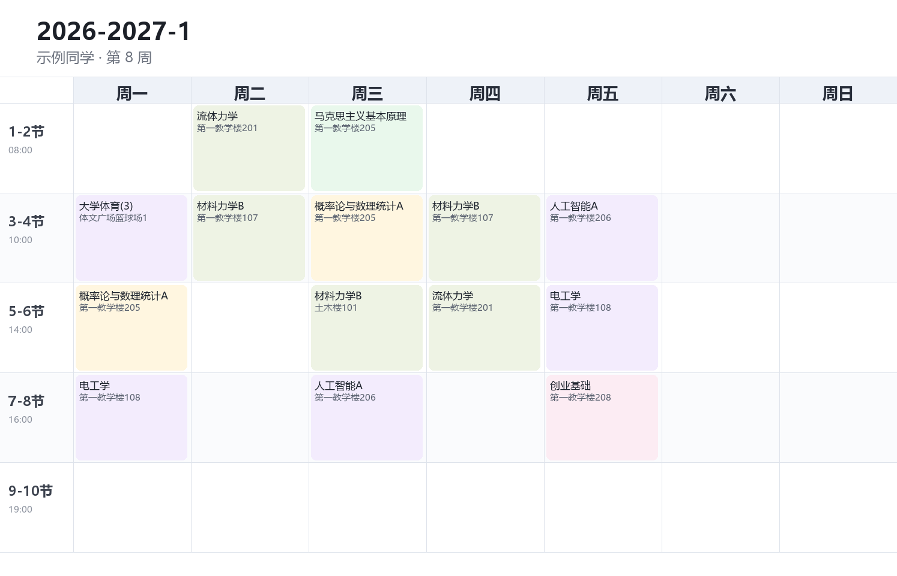
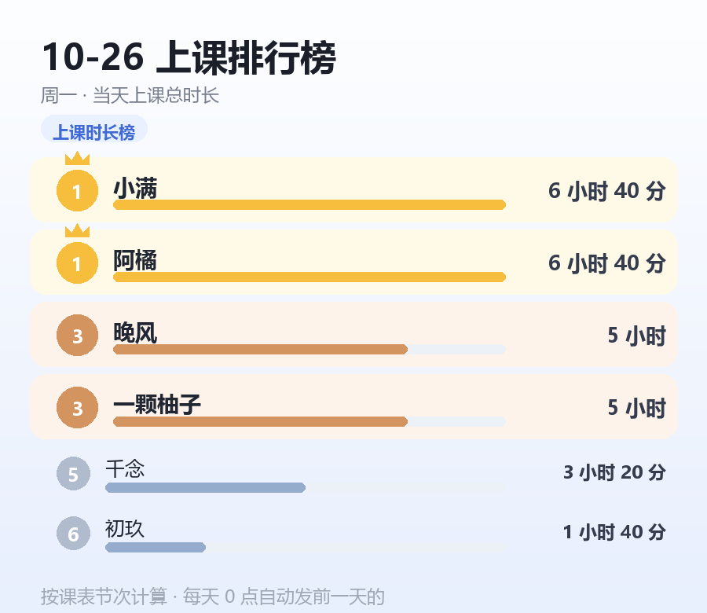

# astrbot_plugin_kebiao · 课表插件

把学校教务系统导出的课表（`.xls` / `.xlsx`）直接发给机器人，自动解析、排好，之后用一句话就能查今天上什么、下一节课在哪、现在谁在上课。

给 AstrBot 用的 QQ 群课表机器人，单人导入、全群可查。

| 周课表 | 上课排行榜 |
| --- | --- |
|  |  |

## 功能

- **导入**：直接把教务导出的课表文件发给机器人，自动识别课程名、老师、周次、节次、地点；导入后原文件即删，不保存学号和姓名。
- **查课表**：整学期课表、本周课表（出图）、今日课表（文字）、下一节课（按当下时间算）。
- **上课提醒**：上课前 20 分钟自动推送到群或个人，群里会 @ 到本人；每人可单独开关。
- **开课播报**：每节课刚开始时，把「现在谁在上课」发到群里（管理员可开关）。
- **抓群友**：看看现在谁在哪栋楼哪个教室，方便线下抓人。
- **谁在上课**：随时查当前正在上课的人。
- **隐身 / 在线**：不想被别人看到时可以隐身（提醒照常推）。
- **上课排行榜**：每天 0 点自动发前一天的上课时长排行，前三名有奖牌样式，时长相同的并列同名次。
- **免斜杠触发**：`周课表`、`今日课表`、`下一节课`、`谁在上课`、`抓群友`、`排行榜`、`上课提醒`、`课表` 这些词不加 `/` 也能用。
- **管理员机制**：AstrBot 主配置里的管理员、群主、群管理员自动算管理员，也可以在群里用命令单独授权。

## 安装

把整个目录放进 AstrBot 的插件目录，重启即可：

```bash
cd /path/to/AstrBot/data/plugins
git clone https://github.com/vvvvdg/astrbot_plugin_kebiao.git
# 重启 AstrBot
```

## 依赖

- Python 包：`xlrd`（读 .xls）、`openpyxl`（读 .xlsx）、`Pillow`（画图）
- 字体：建议容器里装 Noto Sans CJK（`fonts-noto-cjk`），否则中文会回退到系统字体

## 导入课表

1. 登录学校教务系统 → 学期理论课表 → 导出（一般是 `.xls`）
2. 把文件直接发给机器人（支持群聊或私聊，5 MB 以内）
3. 看到「导入成功」后，用 `/课表 开学 2026-09-07` 设一下第 1 周的周一（只需设一次）

## 命令

| 命令 | 说明 |
| --- | --- |
| `/课表` | 帮助 |
| `/课表 全部` | 整学期课表（出图） |
| `/周课表` | 本周课表（出图） |
| `/今日课表` | 今天上什么 |
| `/下一节课` | 现实世界里下一节课 |
| `/谁在上课` | 现在谁在上课 |
| `/抓群友` | 现在去哪个楼哪个教室能抓到谁 |
| `/排行榜` | 今天上课时长排行（`/排行榜 昨天` 看昨天） |
| `/上课提醒` `/上课提醒开` `/上课提醒关` | 提醒开关与状态 |
| `/隐身` `/在线` | 隐身与恢复 |
| `/播报开` `/播报关` | 开课播报开关（管理员） |
| `/管理员` `/管理员 添加 @某人` `/管理员 删除 @某人` | 管理员名单（管理员） |
| `/课表 开学 YYYY-MM-DD` | 设置第 1 周的周一 |
| `/课表 删除` | 清掉已存课表 |

## 数据

- 按 QQ 号存成 `data/<平台>_<QQ>.json`，重启不丢
- 只存课表、昵称和必要的会话标识，不存学号姓名
- 原课表文件解析完立即删除

## 说明

- 周次按「开学日期 + 第几周」推算，寒暑假和调休周需要手动调整开学日期
- 上课时长按节次区间计算（如 1-2 节 = 08:00–09:40）
- 目前不支持临时调课 / 停课，导入的课表为准
